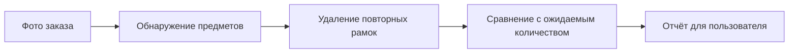

# Поиск предметов по изображениям

Telegram-бот помогает проверить собранный заказ по фотографии. Он отмечает найденные предметы на снимке, сравнивает их число с ожидаемым и показывает, сколько позиций не хватает или сколько оказалось лишними. Неоднозначные результаты можно отправить на ручную проверку.

Я готовил свой датасет, работал с разметкой в Roboflow и обучал модели YOLO для обнаружения и сегментации объектов. В боте использовал Python, aiogram и SQLite. Для плотных раскладок изображение обрабатывается перекрывающимися фрагментами, а повторные обнаружения объединяются по пересечению рамок.



## Код из проекта

- [tiling.py](tiling.py) делит кадр на перекрывающиеся области, переводит рамки из координат фрагмента в координаты кадра и проверяет, какому фрагменту принадлежит центр рамки.
- [detections.py](detections.py) вычисляет IoU и оставляет более уверенное обнаружение, если две рамки сильно пересекаются.
- [count_result.py](count_result.py) сравнивает результат с ожидаемым количеством и формирует итог проверки.
- [visualize.py](visualize.py) рисует пронумерованные рамки и количество объектов поверх изображения.
- [yolo_labels.py](yolo_labels.py) преобразует рамки в строки разметки YOLO.

[count_demo.py](count_demo.py) получает вымышленные рамки, пропускает их через фильтры и печатает итог проверки вместе с разметкой. Для запуска из этой папки достаточно Python со стандартной библиотекой.

```sh
python count_demo.py
```

Для вывода JPEG с рамками используется Pillow. Эта команда создаёт изображение с вымышленными объектами.

```sh
uv run --with pillow python count_demo.py --image preview.jpg
```
