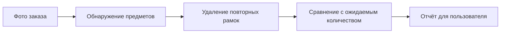

# Поиск предметов по изображениям

Telegram-бот помогает проверить собранный заказ по фотографии. Он отмечает найденные предметы на снимке, сравнивает их число с ожидаемым и показывает, сколько позиций не хватает или сколько оказалось лишними. Неоднозначные результаты можно отправить на ручную проверку.

Я готовил свой датасет, работал с разметкой в Roboflow и обучал модели YOLO для обнаружения и сегментации объектов. В боте использовал Python, aiogram и SQLite. Для плотных раскладок изображение обрабатывается перекрывающимися фрагментами, а повторные обнаружения объединяются по пересечению рамок.

## Код из проекта

- [tiling.py](tiling.py) делит кадр на перекрывающиеся области, переводит рамки из координат фрагмента в координаты кадра и проверяет, какому фрагменту принадлежит центр рамки.
- [detections.py](detections.py) вычисляет IoU и оставляет более уверенное обнаружение, если две рамки сильно пересекаются.
- [count_demo.py](count_demo.py) пропускает через обе стадии вымышленные результаты детектора и сравнивает итог с ожидаемым количеством.

В портфолио геометрия вынесена в самостоятельные функции, а объект обнаружения содержит только рамку и оценку уверенности. Для примера достаточно стандартной библиотеки Python. Из этой папки его можно запустить командой `python count_demo.py`.
