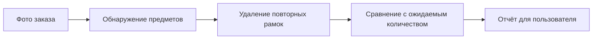

# Поиск предметов по изображениям

Telegram-бот помогает проверить собранный заказ по фотографии. Он отмечает найденные предметы на снимке, сравнивает их число с ожидаемым и показывает, сколько позиций не хватает или сколько оказалось лишними. Неоднозначные результаты можно отправить на ручную проверку.

Я готовил свой датасет, работал с разметкой в Roboflow и обучал модели YOLO для обнаружения и сегментации объектов. В боте использовал Python, aiogram и SQLite. Для плотных раскладок изображение обрабатывается перекрывающимися фрагментами, а повторные обнаружения объединяются по пересечению рамок.

[count_demo.py](count_demo.py) показывает сравнение количества и устранение повторных рамок на вымышленных результатах детектора. Запуск из этой папки: `python count_demo.py`.
