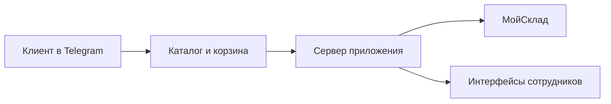

# Интернет-магазин в Telegram

Клиент открывает Telegram Mini App, выбирает товары из каталога и оформляет заказ через корзину. Отдельные интерфейсы помогают администратору и курьеру обрабатывать заказы.

Я работал над каталогом, корзиной, оформлением заказов и интеграцией с API МойСклад. Интерфейс написан на React и TypeScript, серверная часть использует Node.js и Express. Для внутренних данных приложения используется SQLite.



## Код из проекта

| Файл | Что делает |
| --- | --- |
| [variant-service.ts](variant-service.ts) | Группирует варианты по товару, исключает архивные позиции и подставляет остаток и цену из снимка каталога |
| [VariantPicker.tsx](VariantPicker.tsx) | Показывает совместимые характеристики, автоматически выбирает единственный вариант на шаге и добавляет выбранную позицию в корзину |
| [ProductImage.tsx](ProductImage.tsx) | Загружает фото при приближении к видимой области и показывает плейсхолдер при ошибке |
| [CartContext.tsx](CartContext.tsx) | Хранит варианты отдельными строками, учитывает остатки и восстанавливает корзину из `localStorage` |

Сервис принимает снимок каталога через аргументы. React-компоненты используют его результат и данные товара, переданные в свойствах. Для портфолио типы сокращены до нужных полей, а корзина использует отдельный ключ хранения.

Примеры на вымышленных данных запускаются из этой папки через Node.js 24.

```sh
node variant-demo.mjs
node cart-demo.mjs
```

Первый скрипт выполняет код [variant-service.ts](variant-service.ts). Второй показывает отдельный пример расчёта корзины.
