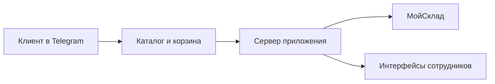

# Интернет-магазин в Telegram

Клиент открывает Telegram Mini App, выбирает товары из каталога и оформляет заказ через корзину. Отдельные интерфейсы помогают администратору и курьеру обрабатывать заказы.

Я работал над каталогом, корзиной, оформлением заказов и интеграцией с API МойСклад. Интерфейс написан на React и TypeScript, серверная часть использует Node.js и Express. Для внутренних данных приложения используется SQLite.

[cart-demo.mjs](cart-demo.mjs) показывает проверку количества товара и расчёт корзины на вымышленных товарах. Запуск из этой папки: `node cart-demo.mjs`.
