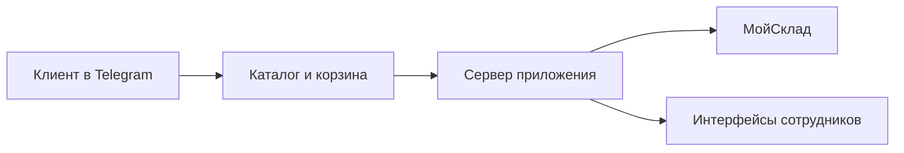

# Интернет-магазин в Telegram

Клиент открывает Telegram Mini App, выбирает товары из каталога и оформляет заказ через корзину. Отдельные интерфейсы помогают администратору и курьеру обрабатывать заказы.

Я работал над каталогом, корзиной, оформлением заказов и интеграцией с API МойСклад. Интерфейс написан на React и TypeScript, серверная часть использует Node.js и Express. Для внутренних данных приложения используется SQLite.

## Код из проекта

[CartContext.tsx](CartContext.tsx) хранит корзину в React Context. Товар и его вариант образуют отдельную строку. При добавлении позиции или изменении количества корзина учитывает остаток, а при расчёте итога использует цену выбранного варианта. Сохранение в `localStorage` восстанавливает корзину после закрытия Telegram WebView.

Для портфолио я определил минимальный тип товара прямо в модуле и заменил ключ хранения. Провайдеру достаточно React и данных о товарах, которые передаёт вызывающий компонент.

[cart-demo.mjs](cart-demo.mjs) — отдельный пример расчёта корзины на вымышленных товарах. Из этой папки его можно запустить командой `node cart-demo.mjs`.
